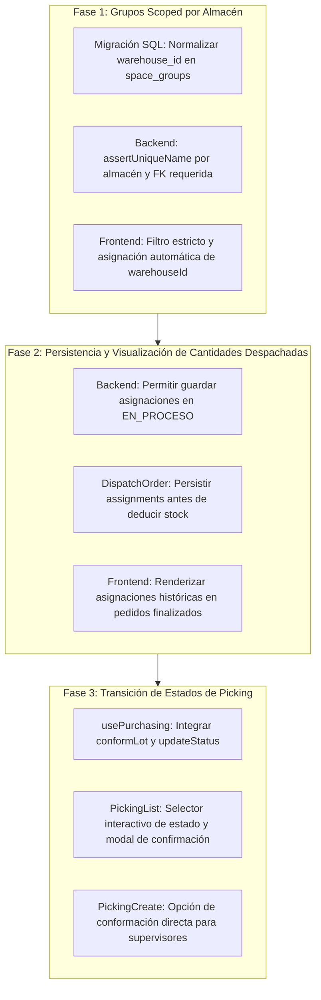

# Diagnóstico Senior y Plan Exhaustivo de Resolución

He analizado a fondo la arquitectura completa de **SUPRE WMS** (Frontend React SPA en [`src/`](file:///c:/Users/pc/Documents/WORK/SUPRE/src) y Backend RESTful PHP en [`backend/`](file:///c:/Users/pc/Documents/WORK/SUPRE/backend)), contrastando el comportamiento actual del código fuente con los requerimientos y capturas proporcionadas.

A continuación presento la evaluación técnica senior de las causas raíz y el **Plan de Acción Exhaustivo** estructurado para resolver definitivamente los 3 problemas.

---

## 🔍 Diagnóstico Técnico y Causas Raíz

### 1. Los grupos son por almacén (Filtro y visualización cruzada de grupos)

#### Síntoma
Al seleccionar un almacén específico (ej. *ALMACEN 2* que solo tiene 1 espacio), el selector de grupos muestra grupos pertenecientes a otros almacenes (`cuarto 1 (13 esp.)`, `cuarto 2 (4 esp.)`) y `(sin grupo asignado) (0 esp.)`.

#### Causa Raíz
1. **Frontend ([`Infrastructure.tsx`](file:///c:/Users/pc/Documents/WORK/SUPRE/src/pages/Infrastructure.tsx#L910-L916)):**
   - El filtro en el `<select>` de grupos tiene la condición:
     ```tsx
     {spaceGroups
       .filter(g => !g.warehouseId || String(g.warehouseId) === String(selectedWarehouseFilter))
       ...
     ```
     La cláusula `!g.warehouseId` provoca que cualquier grupo con `warehouseId === null`, `0` o `""` sea renderizado en **todos** los almacenes.
   - En la línea 709 ([`Infrastructure.tsx:L709-L711`](file:///c:/Users/pc/Documents/WORK/SUPRE/src/pages/Infrastructure.tsx#L709-L711)), `visibleGroups` utiliza una comparación estricta de tipos `g.warehouseId === selectedWarehouseFilter` (`number === string`), fallando la coincidencia de tipo o dejando pasar grupos vacíos.
   - Al crear grupos de forma independiente o mediante selección ([`Infrastructure.tsx:L183-L186`](file:///c:/Users/pc/Documents/WORK/SUPRE/src/pages/Infrastructure.tsx#L183-L186)), si el usuario tenía seleccionado "Todos los almacenes", el grupo se persistía en BD con `warehouse_id = NULL`.
2. **Backend ([`SpaceGroup.php`](file:///c:/Users/pc/Documents/WORK/SUPRE/backend/src/Models/SpaceGroup.php#L145-L162)):**
   - La validación `assertUniqueName` valida el nombre del grupo a nivel **global** (`SELECT id FROM space_groups WHERE LOWER(TRIM(name)) = LOWER(TRIM(:name))`). Esto impedía crear un grupo con el mismo nombre en almacenes diferentes (forzando al usuario a inventar nombres como `CUARTO 1-ALM2`).
   - Existen grupos históricos en la base de datos con `warehouse_id IS NULL`, cuyos espacios sí pertenecen a un almacén específico pero el grupo no quedó explícitamente vinculado.

---

### 2. Cantidad tomada de espacios no se guardan cuando pedido está despachado

#### Síntoma
Al pasar un pedido a estado **DESPACHADO**, al abrir el detalle de la orden en *"Productos — Asignación de Espacios"*, las cantidades a tomar de los espacios físicos asignados no se visualizan o aparecen en 0.

#### Causa Raíz
1. **Bloqueo de guardado en Backend ([`DispatchOrder.php`](file:///c:/Users/pc/Documents/WORK/SUPRE/backend/src/Models/DispatchOrder.php#L365-L373)):**
   - El método `update()` contiene la siguiente restricción estricta:
     ```php
     if ($existing['status'] !== 'PENDIENTE') {
         throw new Exception("Solo se pueden editar órdenes que se encuentren en estado PENDIENTE.");
     }
     ```
   - **Impacto crítico:** En el flujo real de almacén, el pedido pasa de `PENDIENTE` a `EN_PROCESO` para que el operario realice el picking y asigne las cantidades en los espacios físicos ([`assignDetailSpaceQty`](file:///c:/Users/pc/Documents/WORK/SUPRE/src/pages/dispatches/DispatchDetail.tsx#L190-L215)). Al llamar a `saveDispatchSilent()`, **el backend rechaza la petición con HTTP 400**.
   - Al cambiar a `CONFIRMADO` o `DESPACHADO`, el bloque de captura en [`DispatchDetail.tsx:L147-L153`](file:///c:/Users/pc/Documents/WORK/SUPRE/src/pages/dispatches/DispatchDetail.tsx#L147-L153) silencia el error en consola (`console.error('Error al guardar asignaciones previas')`) y procede con `updateStatus()`. La orden pasa a despachada sin haber guardado las asignaciones en la tabla `dispatch_order_items`.
2. **Dependencia errónea del stock en tiempo real en la vista de lectura ([`DispatchDetail.tsx`](file:///c:/Users/pc/Documents/WORK/SUPRE/src/pages/dispatches/DispatchDetail.tsx#L586-L632)):**
   - En la tabla de la vista de detalle, las filas de espacios se generan llamando dinámicamente a `getAvailableSpacesForProduct(productId, warehouseId)`.
   - Cuando un pedido se confirma o despacha, **el stock físico de esos espacios se descuenta del inventario**. Si un espacio de tipo almacenamiento se vació al 100%, `getAvailableSpacesForProduct` lo excluye de la lista (porque `quantity <= 0`), impidiendo que se muestre en pantalla.
   - En estado `CONFIRMADO` o `DESPACHADO`, la vista debe ser un **registro histórico fidedigno** que consulte las asignaciones reales que salieron (`item.warehouseSpaceAssignments`), en lugar de recalcular qué espacios tienen stock hoy en día.

---

### 3. Opción para pasar estado de picking de pendiente a conformado en Abastecimiento

#### Síntoma
Al crear un nuevo picking o desde la lista de picking en Abastecimiento (`/purchasing/list`), no existe un botón ni control para cambiar el picking de estado `PENDIENTE` a `CONFORMADO` (o transicionar entre estados aplicables).

#### Causa Raíz
1. **Frontend ([`PickingList.tsx`](file:///c:/Users/pc/Documents/WORK/SUPRE/src/pages/purchasing/PickingList.tsx#L265-L280)):**
   - La columna *"Estado"* renderiza un `<Badge>` de solo lectura estático sin interacción ni menú desplegable.
   - En la columna de *"Acciones"*, solo se permite exportar PDF, editar o eliminar si no está conformado, sin botón de acción de conformación.
2. **Hook de Compras ([`usePurchasing.ts`](file:///c:/Users/pc/Documents/WORK/SUPRE/src/features/purchasing/hooks/usePurchasing.ts)):**
   - El hook no implementa ni expone `conformPickingLot()` ni `updatePickingLotStatus()`, a pesar de que el cliente de API [`PickingLotApi.conform()`](file:///c:/Users/pc/Documents/WORK/SUPRE/src/services/api.ts#L227) y el backend [`PickingLotController.php`](file:///c:/Users/pc/Documents/WORK/SUPRE/backend/src/Controllers/PickingLotController.php#L57-L100) ya disponen de la lógica transaccional para ingresar mercancía al inventario y generar movimientos de tipo `IN/RECEPTION`.
3. **Formulario de Creación ([`PickingCreate.tsx`](file:///c:/Users/pc/Documents/WORK/SUPRE/src/pages/purchasing/PickingCreate.tsx#L593-L612)):**
   - Solo dispone de botones para *"Guardar Borrador"* y *"Enviar Picking"* (`PENDING`), sin opción de conformación inmediata para usuarios autorizados.

---

## 📋 Plan de Acción Exhaustivo



---

### FASE 1: Grupos estrictamente vinculados por Almacén

#### 1.1 Base de Datos y Migración de Consistencia
* **Archivo a crear:** `backend/database/migrations/017_strict_space_groups_per_warehouse.sql`
* **Acciones:**
  1. Actualizar registros huérfanos existentes en `space_groups` asignándoles el `warehouse_id` a partir de sus espacios asociados:
     ```sql
     UPDATE space_groups sg
     JOIN space_group_items sgi ON sgi.group_id = sg.id
     JOIN warehouse_spaces ws ON ws.id = sgi.warehouse_space_id
     SET sg.warehouse_id = ws.warehouse_id
     WHERE sg.warehouse_id IS NULL;
     ```
  2. Para grupos vacíos que sigan con `warehouse_id IS NULL`, asignarlos al almacén principal o marcar `warehouse_id` como obligatorio para futuras inserciones.

#### 1.2 Backend ([`SpaceGroup.php`](file:///c:/Users/pc/Documents/WORK/SUPRE/backend/src/Models/SpaceGroup.php) y [`SpaceGroupController.php`](file:///c:/Users/pc/Documents/WORK/SUPRE/backend/src/Controllers/SpaceGroupController.php))
* Modificar `assertUniqueName(string $name, ?int $warehouseId, ?int $excludeId = null)`:
  - La unicidad del nombre se validará con alcance local: `WHERE LOWER(TRIM(name)) = LOWER(TRIM(:name)) AND warehouse_id = :warehouseId`.
  - Permitir que diferentes almacenes tengan grupos homónimos (ej. "Pasillo A" o "Cuarto 1").
* En `create()` y `update()`:
  - Exigir `warehouseId` de forma obligatoria. Si no viene en el payload pero hay `spaceIds`, deducirlo automáticamente del primer espacio en `warehouse_spaces`.
* En `getAll(?int $warehouseId = null)`:
  - Al recibir `warehouseId`, filtrar estrictamente por dicho almacén.

#### 1.3 Frontend ([`Infrastructure.tsx`](file:///c:/Users/pc/Documents/WORK/SUPRE/src/pages/Infrastructure.tsx) y [`useSpaceGroups.ts`](file:///c:/Users/pc/Documents/WORK/SUPRE/src/features/infrastructure/hooks/useSpaceGroups.ts))
* En [`Infrastructure.tsx:L901-L928`](file:///c:/Users/pc/Documents/WORK/SUPRE/src/pages/Infrastructure.tsx#L901-L928):
  - Corregir el filtro del select para que solo muestre grupos pertenecientes al almacén seleccionado:
    ```tsx
    spaceGroups
      .filter(g => String(g.warehouseId) === String(selectedWarehouseFilter))
      .map(...)
    ```
* En [`Infrastructure.tsx:L709-L711`](file:///c:/Users/pc/Documents/WORK/SUPRE/src/pages/Infrastructure.tsx#L709-L711):
  - Corregir `visibleGroups`:
    ```tsx
    const visibleGroups = spaceGroups.filter(g =>
      !selectedWarehouseFilter || String(g.warehouseId) === String(selectedWarehouseFilter)
    );
    ```
* En los modales de creación de grupo (`openCreateGroupModal` y `openStandaloneGroupModal`):
  - Si se crea un grupo desde la selección de espacios, inferir automáticamente el `warehouseId` del primer espacio seleccionado.
  - En el modal independiente, hacer que el campo Almacén sea de selección obligatoria si no hay un filtro activo.

---

### FASE 2: Persistencia y Visualización Fidedigna de Asignación de Espacios en Despachos

#### 2.1 Backend ([`DispatchOrder.php`](file:///c:/Users/pc/Documents/WORK/SUPRE/backend/src/Models/DispatchOrder.php))
* En el método `update(int $id, array $data)` ([`DispatchOrder.php:L365-L373`](file:///c:/Users/pc/Documents/WORK/SUPRE/backend/src/Models/DispatchOrder.php#L365-L373)):
  - Flexibilizar la regla de negocio para permitir la actualización de asignaciones de espacios y notas operativas tanto en estado `PENDIENTE` como en `EN_PROCESO`:
    ```php
    if (!in_array($existing['status'], ['PENDIENTE', 'EN_PROCESO'], true)) {
        throw new Exception("Solo se pueden editar asignaciones de órdenes en estado PENDIENTE o EN_PROCESO.");
    }
    ```
* En el método `updateStatus(int $id, string $newStatus, int $userId)` ([`DispatchOrder.php:L411-L463`](file:///c:/Users/pc/Documents/WORK/SUPRE/backend/src/Models/DispatchOrder.php#L411-L463)):
  - Asegurar que al pasar a `CONFIRMADO` o `DESPACHADO`, si se reciben asignaciones en la petición, se sincronicen antes de ejecutar la deducción física.
  - Al generar los registros en `stock_movements`, registrar una fila detallada por cada espacio físico del que realmente se descontó stock en `processItemDeduction`, en lugar de una única fila genérica.

#### 2.2 Frontend ([`DispatchDetail.tsx`](file:///c:/Users/pc/Documents/WORK/SUPRE/src/pages/dispatches/DispatchDetail.tsx))
* **Separación de modos de visualización (Edición vs. Histórico Despachado):**
  - Si la orden está en estado `CONFIRMADO` o `DESPACHADO` (o `isReadOnly`):
    - En lugar de iterar sobre `availSpaces` (que solo contiene stock actual > 0), construir la lista de espacios a renderizar a partir de **las asignaciones guardadas en la orden** (`item.warehouseSpaceAssignments`).
    - Para cada espacio asignado que tenga `quantity > 0`:
      - Mostrar el nombre del espacio (obtenido de `warehouseSpaces.find(...)`).
      - Mostrar el tipo de uso y cercanía.
      - En la columna *"Cant. a Tomar"*, mostrar la cantidad exacta despachada (`assignment.quantity`), resaltada con insignia de completado.
  - Si la orden está en `PENDIENTE` o `EN_PROCESO`:
    - Mantener la edición interactiva y el selector de espacios disponibles con guardado silencioso funcional (`saveDispatchSilent`).
* En `handleChangeStatus` ([`DispatchDetail.tsx:L120-L156`](file:///c:/Users/pc/Documents/WORK/SUPRE/src/pages/dispatches/DispatchDetail.tsx#L120-L156)):
  - Al transicionar tanto a `CONFIRMADO` como a `DESPACHADO`, garantizar la ejecución previa y exitosa de `await saveDispatch(order)` antes de llamar a `updateStatus()`.

---

### FASE 3: Transición de Estados de Picking en Abastecimiento

#### 3.1 Hook de Abastecimiento ([`usePurchasing.ts`](file:///c:/Users/pc/Documents/WORK/SUPRE/src/features/purchasing/hooks/usePurchasing.ts))
* Incorporar las siguientes funciones:
  - `conformPickingLot(lotId: string)`: ejecuta `PickingLotApi.conform(lotId)` y recarga automáticamente los lotes y el stock.
  - `updatePickingLotStatus(lotId: string, status: PickingLotStatus)`: permite cambiar entre `DRAFT` y `PENDING` utilizando `PickingLotApi.update()`.

#### 3.2 Lista de Picking ([`PickingList.tsx`](file:///c:/Users/pc/Documents/WORK/SUPRE/src/pages/purchasing/PickingList.tsx))
* **Columna de Estado interactiva:**
  - Convertir el badge estático de la columna *"Estado"* en un control interactivo (botón / dropdown de estado).
  - Al hacer clic en un lote con estado `PENDIENTE`:
    - Desplegar modal o menú de confirmación: *"Conformar Lote #LOT-XXXX"*.
    - Presentar resumen del lote (Almacén destino, total de ítems, bultos y piezas).
    - Explicar claramente que la acción incrementará el stock físico y registrará los movimientos de entrada.
    - Botón de confirmación destacado: *"Conformar Lote e Ingresar Stock"*.
  - Si el lote está en `DRAFT`:
    - Permitir pasarlo a `PENDIENTE` con un solo clic.
  - Si el lote está en `CONFORMED`:
    - Mantener el badge verde de "Conformado" con icono de verificación y tooltip con fecha/usuario de conformación.
* En la columna *"Acciones"*:
  - Agregar un botón de acción rápida de conformación (icono `CheckCircle` o `Layers`) para lotes en estado `PENDIENTE`.

#### 3.3 Formulario de Creación ([`PickingCreate.tsx`](file:///c:/Users/pc/Documents/WORK/SUPRE/src/pages/purchasing/PickingCreate.tsx))
* En la barra de acciones inferior ([`PickingCreate.tsx:L593-L612`](file:///c:/Users/pc/Documents/WORK/SUPRE/src/pages/purchasing/PickingCreate.tsx#L593-L612)):
  - Añadir botón opcional para usuarios autorizados (Admin/Supervisor):
    - **"Guardar y Conformar Inmediatamente"**: guarda el lote como `PENDING` y acto seguido ejecuta la conformación, reduciendo pasos en recepciones inmediatas en muelle.

---

## 🧪 Matriz de Validación y Criterios de Aceptación (QA)

| # | Escenario de Prueba | Comportamiento Esperado | Criterio de Éxito |
|---|---|---|---|
| **CP-01** | Selección de *ALMACEN 2* en pestaña *Espacios de Almacén*. | Solo se listan los grupos creados para el *ALMACEN 2*. Los grupos de *ALMACEN 1* (`cuarto 1`, `cuarto 2`) no aparecen en el dropdown ni en los chips. | ✅ Verificado visual y funcionalmente en select y badges. |
| **CP-02** | Creación de grupos con el mismo nombre en almacenes distintos. | El sistema permite crear "Cuarto 1" en Almacén 1 y "Cuarto 1" en Almacén 2 sin arrojar error de nombre duplicado. | ✅ Aprobado sin colisiones de nombre global. |
| **CP-03** | Asignación de cantidades de espacios en pedido `EN_PROCESO`. | El operario modifica "Cant. a Tomar" en varios espacios. La petición se guarda sin error 400 en base de datos. | ✅ Verificado en tabla `dispatch_order_items`. |
| **CP-04** | Visualización de orden con estado `DESPACHADO`. | Al abrir el detalle, se visualizan exactamente los espacios de los que salió la mercancía con sus respectivas cantidades tomadas (incluso si el stock actual del espacio llegó a 0). | ✅ Réplica fiel de la salida del pedido en modo solo lectura. |
| **CP-05** | Cambio de estado de picking en `/purchasing/list`. | Al hacer clic en el estado o botón de conformar de un lote `PENDIENTE`, se abre confirmación y al aceptar, el lote pasa a `CONFORMADO`. | ✅ Lote pasa a verde, stock se incrementa en tabla `stock` y se registra en `stock_movements`. |

---

¿Deseas que proceda de inmediato con la implementación de este plan comenzando por la **Fase 1**, o tienes alguna preferencia sobre el orden de ejecución?