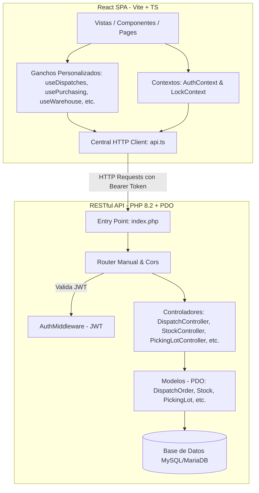

# SUPRE WMS — Mapa de Arquitectura y Conectividad (SUPRE_MAP)

Este documento describe la arquitectura global, las rutas principales, las dependencias críticas y la conectividad del sistema **SUPRE WMS** (Warehouse Management System), diseñado bajo una estructura desacoplada que separa un frontend SPA reactivo de un backend RESTful liviano y eficiente.

---

## 🏛️ 1. Arquitectura General del Sistema

El sistema está compuesto por dos grandes piezas independientes que interactúan mediante peticiones HTTP asíncronas sobre formato JSON:



### 🔹 Frontend (React SPA)
* **Paradigma:** Single Page Application (SPA) modular estructurada bajo una arquitectura orientada a características (**Feature-Driven Development**).
* **Gestión de Estado:** Manejo de datos locales a través de hooks personalizados (`useDispatches`, `usePurchasing`, `useWarehouse`, `useCatalog`, etc.) que encapsulan las llamadas a servicios y reducen la lógica en componentes visuales. El estado global crítico (sesión de usuario y bloqueos de seguridad en tiempo real) se administra con React Contexts (`AuthContext` y `LockContext`).
* **Optimización UX y Persistencia Silenciosa:** Implementa guardados en segundo plano (`saveDispatchSilent`) para prevenir recargas innecesarias (`isLoading = false`), manteniendo la fluidez de entrada en formularios numéricos sin parpadeo de interfaz ni pérdida de foco.
* **Control de Autorización Física/Digital ("Locks"):** Integra un sistema de llaves de acceso dinámicas controladas por el contexto `LockContext` y consumidas en caliente desde `LockApi`. Permite validar con códigos o autorizaciones de supervisor acciones críticas en la aplicación (ej: eliminar stock, aprobar compras, desincorporaciones) sin alterar el flujo UX principal.

### 🔹 Backend (RESTful API)
* **Paradigma:** Arquitectura de microservicios MVC modificada sin frameworks robustos (PHP puro, alto rendimiento y control total del ciclo de vida).
* **Enrutamiento:** Implementa un router manual de expresiones regulares optimizado en `backend/public/index.php` para resolver recursos en microsegundos.
* **Persistencia:** Capa de abstracción de base de datos directa sobre **PDO** (PHP Data Objects) implementada bajo el patrón **Singleton** para optimizar el pool de conexiones a MySQL/MariaDB.

---

## 📁 2. Estructura del Proyecto y Conectividad de Archivos

### 🌐 Frontend (Carpeta `src/`)

La estructura está distribuida en subcarpetas enfocadas en la separación de responsabilidades:

```
src/
├── App.tsx                    # Enrutador general y provisión de contextos globales
├── main.tsx                   # Punto de inicio e inyección del DOM de React
├── types.ts                   # Definición de tipos TypeScript compartidos en toda la app
├── components/                # Componentes comunes del sistema (Layout, Sidebar, Modales, Table, Input, Button)
│   ├── QRScannerModal.tsx     # Modal unificado de escaneo (QR y Códigos de Barra)
│   ├── BarcodeDisplay.tsx     # Renderizador e impresor SVG de Código de Barras CODE128
│   └── ...
├── context/                   # Proveedores de estado global (AuthContext y LockContext)
├── services/                  # Capa de consumo de APIs externas e internas (api.ts, storage.ts)
├── pages/                     # Páginas base del sistema (Dashboard, Infrastructure, Warehouse, etc.)
│   ├── purchasing/            # Módulo Independiente de Abastecimiento:
│   │   ├── PurchasingLayout.tsx       # Shell con pestañas de navegación del módulo
│   │   ├── PickingList.tsx            # Lista interactiva de lotes, filtros y exportación PDF
│   │   ├── PickingCreate.tsx          # Creación/Edición con escáner QR/barras y tabla optimizada
│   │   ├── ProductIdentifierLabel.tsx # Generador e impresor de Etiquetas 60x40mm (Nombre/Cat/Cant)
│   │   └── ProductBarcodeLabel.tsx    # Generador e impresor de Etiquetas 60x40mm (Código/Barras/QR)
│   ├── dispatches/            # Módulo de Ordenes de Despacho:
│   │   ├── DispatchesLayout.tsx       # Shell con pestañas de navegación del módulo
│   │   ├── DispatchList.tsx           # Resumen por estados y lista interactiva de órdenes
│   │   ├── DispatchCreate.tsx         # Formulario de creación directa de orden
│   │   ├── DispatchDetail.tsx         # Detalle del pedido, asignación de espacios y cant. a tomar
│   │   ├── DispatchPrint.tsx          # Generador e impresor PDF de Órdenes de Despacho
│   │   ├── DispatchPrintNote.tsx      # Diseñador PDF e historial de Notas de Entrega
│   │   └── DispatchPrintPreviewModal.tsx # Modal de vista previa e impresión nativa/PDF
│   └── Disincorporation.tsx   # Módulo independiente de Desincorporaciones
└── features/                  # Módulos de lógica y UI estructurados por dominio:
    ├── catalog/               # Catálogo: Productos, categorías, proveedores
    ├── disincorporation/      # Mermas y salidas autorizadas
    ├── dispatches/            # Ganchos personalizados de despachos (useDispatches.ts)
    ├── infrastructure/        # Configuración espacial (Almacenes, Estantes, Ubicaciones)
    ├── locks/                 # Gestión de llaves y candados de seguridad
    ├── purchasing/            # Ganchos personalizados de abastecimiento (usePurchasing.ts)
    └── warehouse/             # Gestión de stock, modales de edición (Admin/Spaces) e inventariado físico
```

---

## 🛣️ 3. Rutas Principales del Sistema

### 🗺️ Rutas del Frontend (React Router DOM)

| Ruta | Componente / Página | Propósito del Módulo |
|---|---|---|
| `/login` | `src/pages/Login.tsx` | Autenticación del usuario al sistema. |
| `/` | `src/pages/Dashboard.tsx` | Visualización general e indicadores clave de rendimiento (KPIs). |
| `/catalog` | `src/features/catalog/pages/CatalogPage` | CRUD de productos, costos, precios y dimensiones. |
| `/categories` | `src/features/catalog/pages/CategoriesPage` | Categorización, gestión de fraccionamiento e importación/exportación CSV. |
| `/providers` | `src/features/catalog/pages/ProvidersPage` | CRUD de proveedores y catálogos de origen. |
| `/infrastructure`| `src/pages/Infrastructure.tsx` | Creación de almacenes, tipos de espacios y sub-ubicaciones espaciales. |
| `/warehouse` | `src/pages/Warehouse.tsx` | Panel de control de Stock, reubicaciones, edición por espacio y picking list de salida. |
| `/purchasing/list` | `src/pages/purchasing/PickingList.tsx` | Lista de lotes de picking con filtros y exportación PDF. |
| `/purchasing/new` | `src/pages/purchasing/PickingCreate.tsx` | Creación y edición de lotes con escaneo QR/barras. |
| `/purchasing/product-label` | `src/pages/purchasing/ProductIdentifierLabel.tsx` | Generador de etiqueta identificadora 60x40mm en JPG/impresión. |
| `/purchasing/code-label` | `src/pages/purchasing/ProductBarcodeLabel.tsx` | Generador de etiqueta con código de barra CODE128 o QR 60x40mm. |
| `/dispatches/list` | `src/pages/dispatches/DispatchList.tsx` | Lista de órdenes de despacho con filtros por estado. |
| `/dispatches/new` | `src/pages/dispatches/DispatchCreate.tsx` | Creación directa de órdenes de despacho manuales. |
| `/dispatches/detail` | `src/pages/dispatches/DispatchDetail.tsx` | Vista de detalle de orden y asignación de cantidades. |
| `/dispatches/print-note`| `src/pages/dispatches/DispatchPrintNote.tsx` | Diseñador e historial local de Notas de Entrega personalizadas. |
| `/disincorporation`| `src/pages/Disincorporation.tsx` | Módulo independiente de registro de mermas, daños y robos. |
| `/movements` | `src/pages/StockMovements.tsx` | Kardex / Historial detallado de todas las transacciones físicas del stock. |
| `/locks` | `src/features/locks/pages/LocksPage` | Catálogo e interruptores de llaves físicas y digitales del almacén. |
| `/settings` | `src/pages/Settings.tsx` | Parámetros del sistema y control de perfiles y usuarios. |

---

## 🔒 4. Reglas de Negocio Críticas e Integridad del Sistema

1. **Abastecimiento con Escaneo Térmico y Bultos:**
   - La creación de picking permite ingresar productos tipeando o escaneando su código de barras o QR físico. La tabla omite el campo de alerta general y calcula automáticamente las cantidades totales según el desglose de bultos.
2. **Generación Térmica de Etiquetas (60mm x 40mm):**
   - El sistema proporciona dos generadores de etiquetas a escala real (300 DPI - 708x472 px) con exportación en JPG/PNG e impresión térmica directa.
3. **Independización de Operaciones:**
   - Abastecimiento y Desincorporación operan como módulos de primer nivel con accesos y permisos independientes en la barra lateral.
